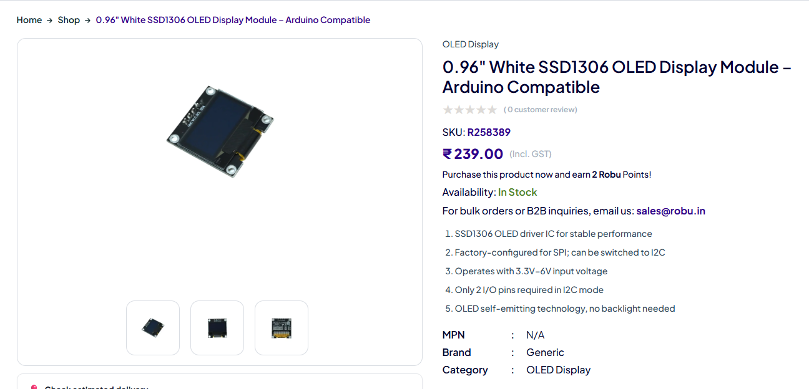
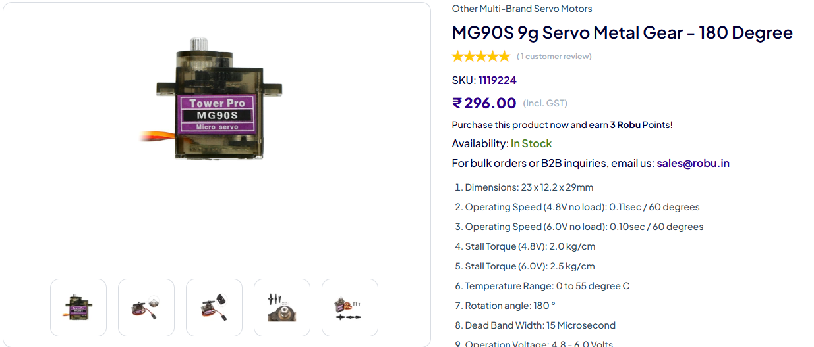
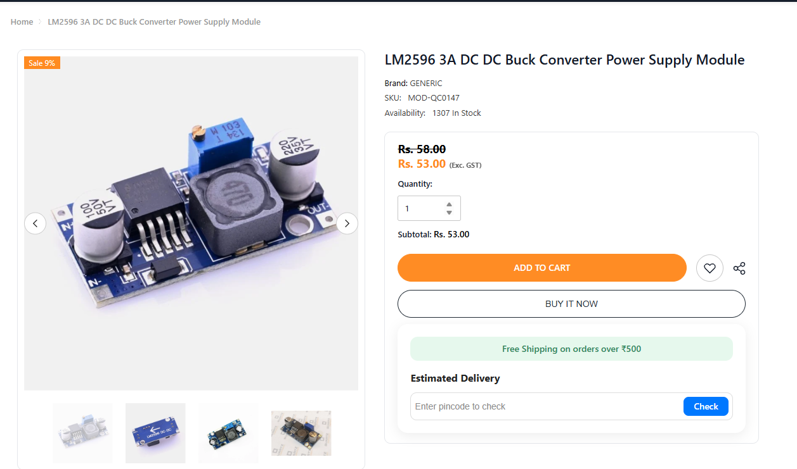
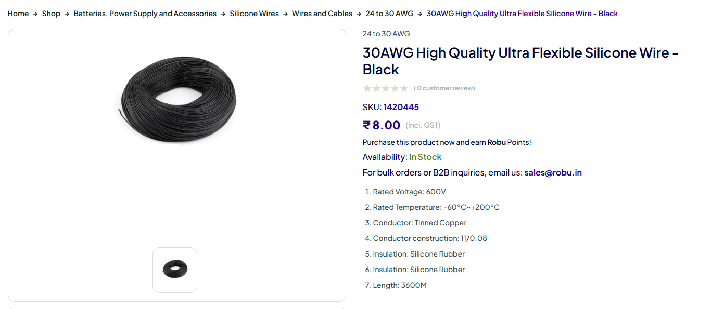
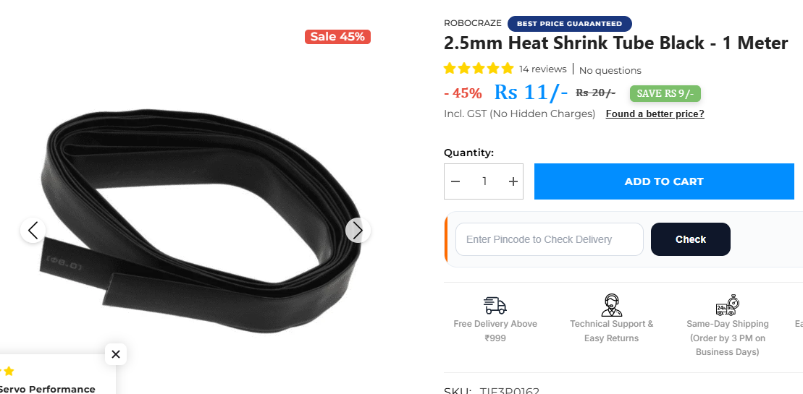

## November 19, 2026: Project setup and file structure

Created the file structure and finalized the project scope and features created basic strucutre with all the folders and all made sure it fits well with fabricate sync structure

**Total time spent: 0.3h**

## November 20, 2026: Sourcing parts and making the BOM

Spent today picking all the parts for Kumo and putting them in the [BOM](https://github.com/Rexaintreal/Kumo/blob/main/BOM.csv). Its based on Sesame so i started from its parts list and changed stuff to fit my own features like ML and TTS

### Brain and display

The brain is an ESP32-S2 Mini. Small with built in wifi and enough pins for all the servos and the screen

For the face i went with an OLED so Kumo can show different emotions while walking

### Motion and power

Legs run on servo motors, one for each joint

Servos pull a lot of current and the ESP32 needs a steady supply so there is a buck converter to bring the battery voltage down. Also added a switch to turn the whole robot on and off

### Wiring

For connections i got a prototype board, header pins so stuff can be unplugged and terminal wire for the power lines

Legs move all the time so the wires need to be soft. Silicone wire bends way easier than normal wire and wont snap after a lot of movement

### Small hardware

Screws for the body and servo mounts, heat shrink for solder joints and zip ties to keep the cables tidy

### Still unfinished

The BOM is not done yet Still need to fix the power supply and figure out the DC to DC connector setup. Once thats sorted i can start the CAD for the body and legs :3

**Total time spent: 1.7h**
