    ---
title: "Kumo"
github: "https://github.com/Rexaintreal/Kumo"
description: "A smart, expressive quadruped walking robot with ML and TTS, based on Sesame."
created_at: "2026-11-19"
total_time: "4.0h"
---

## November 28, 2026: Starting the schematic and making custom symbols

Started the schematic today in KiCad :D! as kumo is hand wired on a protoboard/breadboard i only need a schematic no pcbs heh i started setting up the project in the schematics folder and filled in the title block with a credit to Sesame since the whole thing is based on it

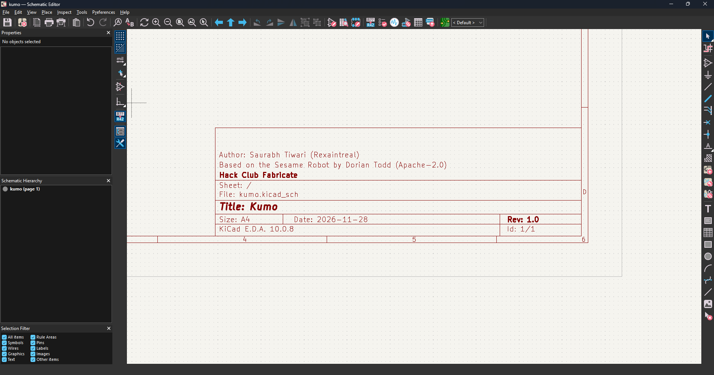

### Librariess :cryin

It took me a while here kicad is a bit weird with libraries it constantly complained about how kumo as a library already exists and the symbol editor was not allowing me to create any symbols after some help with ai turns out it was in the global library and was set to a file location which never existed i deleted that and saved ti to project library!

### ESP32-S2 Mini symbol

I failed to find any symbol for it so i made my own with only the pins i actually use 10 GPIO pins on the left. IO1 2 4 6 8 10 13 14 are the servos same pins as the Sesame firmware uses for the S2 Mini so i can reuse their code without editing pins IO33 and IO35 are SDA and SCL for the OLED. 5V GND and 3V3 on the right

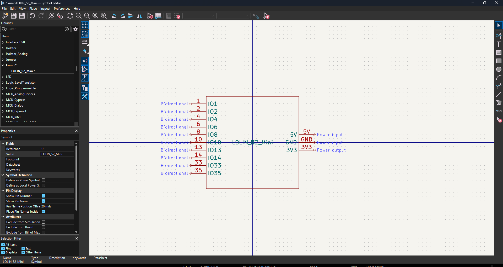

### LM2596 module

The buck converter is a ready made module so there is nothing inside to draw. Just a box with IN+ IN- OUT+ OUT-. Set all the pins to passive so KiCad does not complain about power pins later

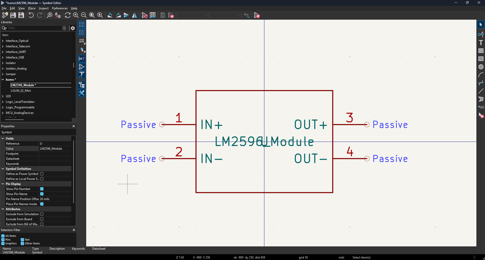

### Battery connector

JST SM 4 pin with BAT+ and BAT- and two unconnected pins. This pinout is a guess for now. I will check it with a multimeter when the battery arrives and fix the symbol if its wrong

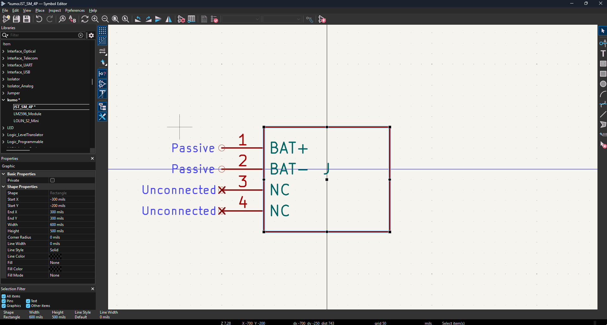

**Total time spent: 1.5h**

## November 27, 2026: Finishing the BOM and fixing the power supply

was really busy with practicals finally got time for kumo, The BOM was unfinished last time because the power supply was not sorted T_T so thats what i fixed today in the [BOM](https://github.com/Rexaintreal/Kumo/blob/main/BOM.csv) is done now except the 3D prints whihc will be added later

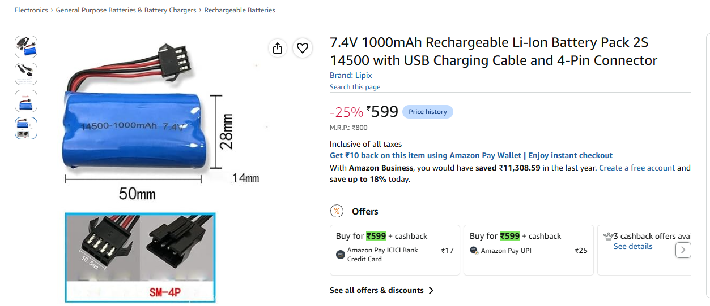

### Power supply

sooo i picked a 7.4V 1000mAh 2S 145 00 pack with a Charging cable included so no separate charger needed ig its a bit weird as the listing has no reviews and 1000mAh seems too much for 14500 cells so i will check the real specs when i receive it The LM2596 buck stays and will be set to 5.1V with a multimeter before anything gets connected just to be safe :pray

### Connector

intiially i thought of an XH2.54 3 pin pigtail but the battery comes with a 4 pin SM plug so that would not even fit i swapped it for a JST SM 4 pin connector with wire Its only rated for about 1A so the main power path will use the thicker 22AWG silicone wire!

- Final total is about $44.82 or ₹4194

### Not in v1

alsoooo i am skipping the mic and speaker sadly :( for v1 so ML and TTS will come later and 3d printing will be done by a print on demand service in my city so i will get a quote once the CAD is ready!!!

**Total time spent: 0.5h**

## November 19, 2026: Project setup and file structure

Created the file structure and finalized the project scope and features created basic strucutre with all the folders and all made sure it fits well with fabricate sync structure

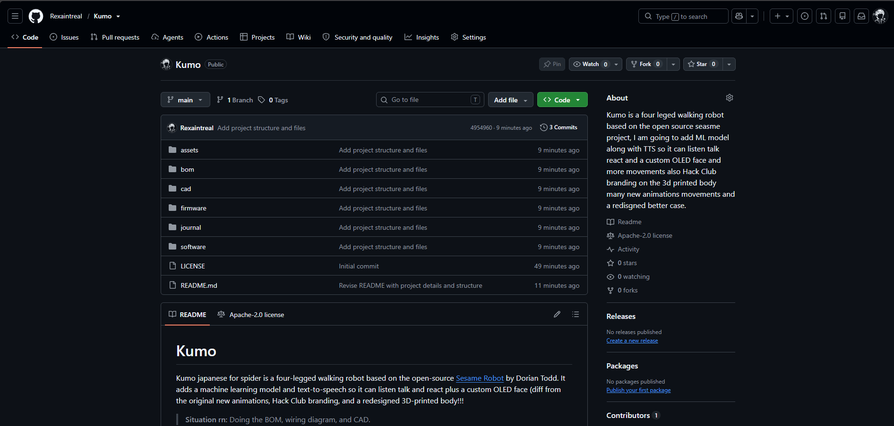

**Total time spent: 0.3h**

## November 20, 2026: Sourcing parts and making the BOM

Spent today picking all the parts for Kumo and putting them in the [BOM](https://github.com/Rexaintreal/Kumo/blob/main/BOM.csv). Its based on Sesame so i started from its parts list and changed stuff to fit my own features like ML and TTS

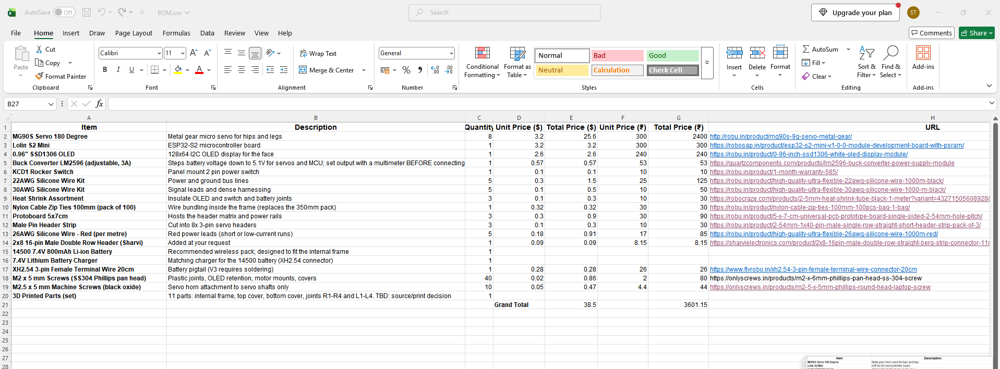

### Brain and display

The brain is an ESP32-S2 Mini. Small with built in wifi and enough pins for all the servos and the screen

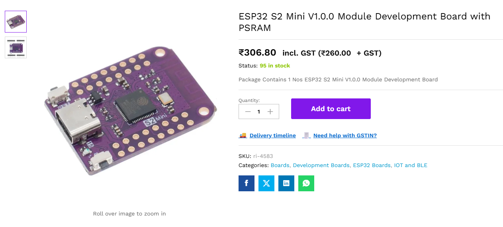

For the face i went with an OLED so Kumo can show different emotions while walking

### Motion and power

Legs run on servo motors, one for each joint

Servos pull a lot of current and the ESP32 needs a steady supply so there is a buck converter to bring the battery voltage down. Also added a switch to turn the whole robot on and off

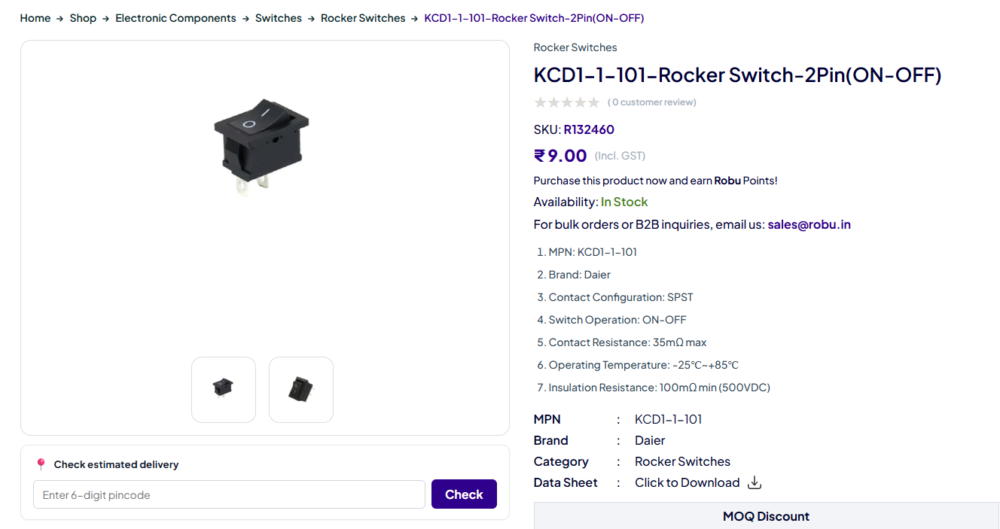

### Wiring

For connections i got a prototype board, header pins so stuff can be unplugged and terminal wire for the power lines

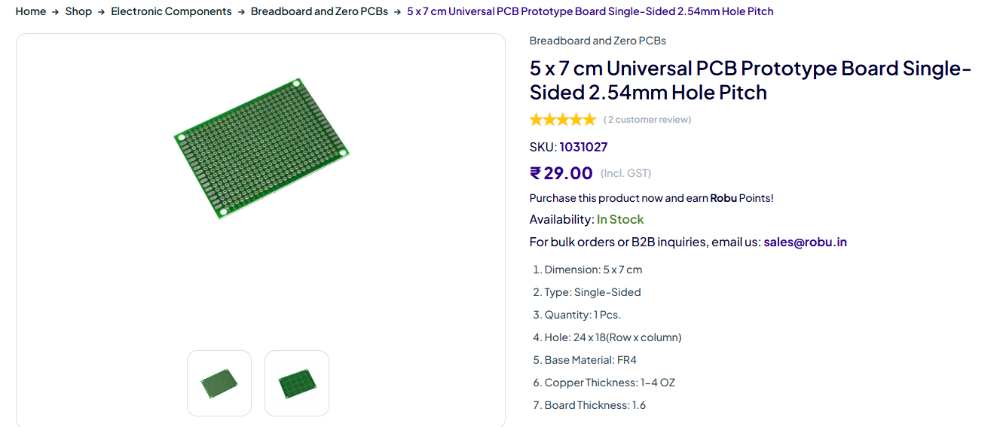

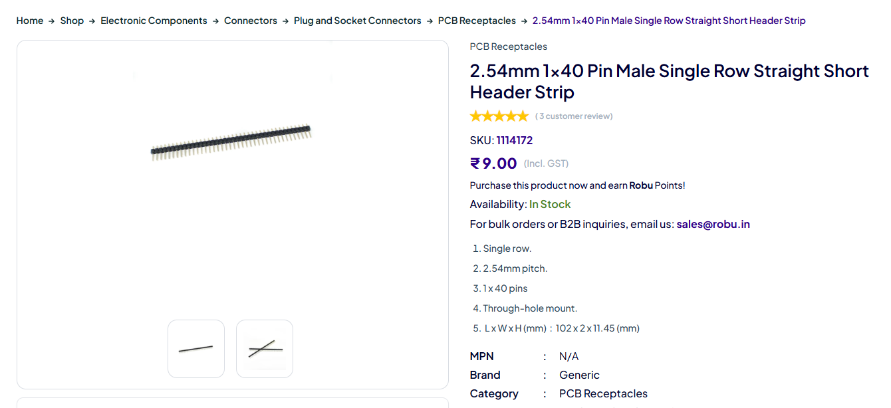

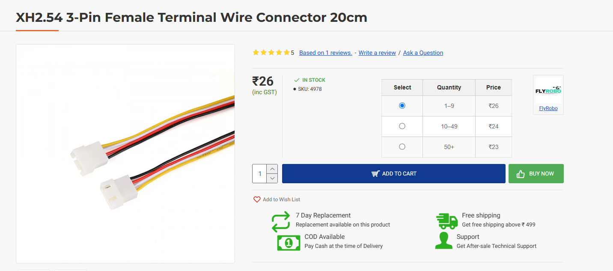

Legs move all the time so the wires need to be soft. Silicone wire bends way easier than normal wire and wont snap after a lot of movement

### Small hardware

Screws for the body and servo mounts, heat shrink for solder joints and zip ties to keep the cables tidy

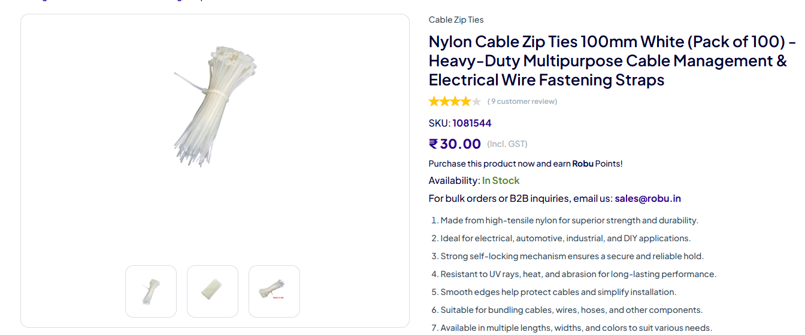

### Still unfinished

The BOM is not done yet Still need to fix the power supply and figure out the DC to DC connector setup. Once thats sorted i can start the CAD for the body and legs :3

**Total time spent: 1.7h**
