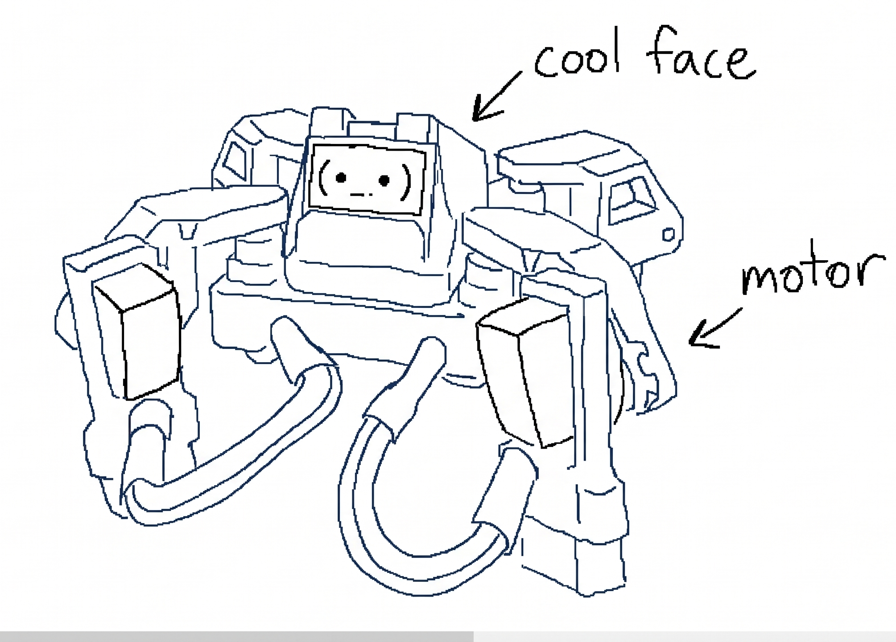

<h1 align="center">Kumo</h1>

  

Kumo japanese for spider is a four-legged walking robot based on the open-source [Sesame Robot](https://github.com/dorianborian/sesame-robot) by Dorian Todd. It adds a machine learning model and text-to-speech so it can listen talk and react plus a custom OLED face (diff from the original new animations, Hack Club branding, and a redesigned 3D-printed body!!!

> **Situation rn:** Doing the wiring diagram, and CAD.

## Journal

I'm logging my progress regularly in the [`journal/`](journal/) folder.

## Credits
- [Sesame Robot](https://github.com/dorianborian/sesame-robot) by Dorian Todd (Apache-2.0), which Kumo is based on.

## License
Licensed under the [Apache License 2.0](LICENSE).
